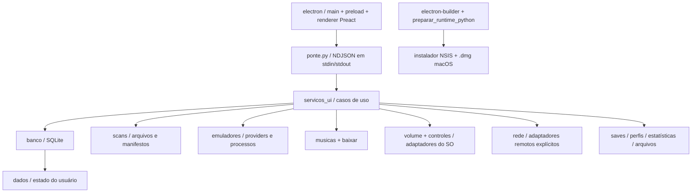

# Arquitetura e mapa de pastas

## Visão geral



As regras ficam no núcleo; o desktop Electron só apresenta (fala com o
núcleo pela ponte). Os casos de uso importam direto o módulo dono de cada
função (`from bib_nucleo import banco`; a fachada `bib_core` saiu na 2.0).
Os módulos possuem alguns imports locais deliberados para desfazer ciclos
entre banco, scanners e providers. O app Electron é a única interface, no
Windows e no macOS (detalhes em [DESKTOP_ELECTRON.md](DESKTOP_ELECTRON.md));
Linux roda pelos fontes. Qt Quick, o modo clássico Tk e a TUI curses foram
removidos.

## Árvore comentada

```text
Tucoteca/
├── README.md                         entrada funcional e técnica
├── LICENSE                           licença do código do Hub
├── AGENTS.md                         regras de trabalho (pessoas e agentes)
├── pyproject.toml                    projeto Python, Ruff, pytest e mypy
├── TucoTeca.bat                      Windows pelos fontes (o usuário final usa o instalador)
├── .github/workflows/                CI: suíte em Windows/Linux/macOS, .dmg e instalador
├── docs/
│   ├── ARQUITETURA.md                 este mapa
│   ├── DESKTOP_ELECTRON.md            telas, ponte, controle, segurança, provas
│   ├── INTEGRACOES.md                 como acrescentar integração/provedor
│   ├── CONTRIBUTING.md                ambiente, testes e convenções
│   ├── RELEASES.md                    instalador, anexos e publicação
│   ├── ROADMAP.md                     estado e próximos passos
│   ├── SECURITY.md                    contato e superfície de risco
│   ├── LEGAL.md                       aviso legal
│   ├── CHANGELOG.md                   notas por versão
│   └── exemplos/provedor_modelo.py    template de provedor de rede
├── codigo/
│   ├── VERSION                       versão atual (também no app instalado)
│   ├── bib_nucleo/                   núcleo e domínios pessoais
│   │   └── rede/                     adaptadores com BIBLIOTECA_REDE
│   ├── frontends/                    ponte, casos de uso e Electron
│   │   └── electron/                 app desktop (main/preload/renderer)
│   ├── ferramentas/                  diagnóstico, entrega e builders
│   │   ├── preparar_release.py        anexos da release (instaladores + fontes)
│   │   └── testes/                   casos e runner em sandbox
│   └── historico/                    arquivo local, ignorado
├── programa/                         runtime instalado localmente, ignorado
├── dados/                            coleção local, ignorada
└── dist/                             gerados, ignorados
```

`codigo/ferramentas/.cache/` guarda downloads de build e `.build/` guarda
árvores intermediárias. Não são fontes, não entram na entrega de engenharia.
As pastas físicas locais podem conter material de sessões antigas; o comando
de entrega seleciona somente fontes/documentos por allowlist.
Um clone limpo não precisa conter `programa/`, `dados/` ou `dist/`.
A pasta do projeto pode ser a **única** do PC: com `dados/` e `programa/`
na raiz (ambos ignorados pelo Git), `resolve_home()` em `base.py` prefere a
própria árvore à instalação canônica — bundles e clone dev compartilham a
mesma regra. Links do Wine (`dosdevices/*`, junctions de pastas do usuário)
não são copiáveis pelo Windows e são recriados pelo Wine no primeiro uso.

## Responsabilidade por módulo

| Módulo | Responsabilidade / fronteira |
|---|---|
| `config.py` | leitura única das `BIBLIOTECA_*` (paths, listas `;`/`,`, bools 0/1), defaults e singleton `cfg` — consumida por `base.py`, builders e testes |
| `base.py` | casa, raízes Win/Linux/Mac, tradução de caminhos, lock, texto, logs |
| `banco/` (pacote) | schema, migrações por colunas, CRUD jogos/músicas/fila, capas — fatiado em `_infra`/`jogos`/`catalogo` com fachada de compatibilidade (`__all__` idêntico) |
| `banco/desejos.py` | wishlist local, sincronização preservadora e histórico obtido |
| `banco/meta.py` / `banco/colecoes.py` | metadados dos provedores por `uuid` (com campos travados pela edição manual) e coleções de jogos; ambos viajam no pacote |
| `scans/` (pacote) | lojas/disco/ROMs e leitor do Hydra (`scans/hydra.py`), preview, dedup e restore |
| `emuladores/` (pacote) | Azahar/DeSmuME, processos/sessões, presets e overlay de mods — fatiado na F1 do O2 sem mudar contratos |
| `atualizacao.py` | download e atualização transacional, manifesto, rollback |
| `pacotes.py` | JSON, ZIP de coleção e backups versionados |
| `lixeira.py` | snapshot e desfazer de remoções (jogos com capa, desejos, vídeos); música fora por design |
| `arquivos.py` | temporário no mesmo disco + publicação atômica |
| `rede/repacks.py` (alias `repacks.py`) | extrair, organizar, selecionar exe, importar e confirmar archive |
| `cheats.py` | texto Gateway com liga/desliga e TID canônico |
| `texturas.py` | instalar/toggle/estado de packs por TID |
| `controles.py` | detecção de gamepads, formatos de binds e presets `[Controls]` |
| `musicas.py` | ID3/fallback, arquivos de áudio, capas de álbum e path portátil |
| `baixar.py` | Exportify, yt-dlp/FFmpeg, staging, conversão e fila persistente |
| `volume.py` | volume geral Windows Core Audio; COM com vida limitada |
| `rede/fontes.py` | busca nos catálogos SteamRip/FitGirl e wishlist da Steam (só título e link; abrir/baixar é com o usuário) |
| `rede/metadados.py` / `rede/binarios.py` | Steam de referência e instalação verificada de ferramentas |
| `rede/letras.py` / `rede/capas_libretro.py` / `rede/sponsorblock.py` | LRCLIB/LRC, capas e segmentos opt-in |
| `rede/provedores/` | Steam, SteamGridDB e RetroAchievements para a página do jogo: cache com validade, ritmo por host, HTML vira texto, arte em `dados/artes/<uuid>/` |
| `rede/loja_steam.py` | vitrine, busca e página pública da loja Steam (pt-BR, preço BR) |
| `rede/cinemeta.py` | catálogo, busca e ficha do Cinemeta (filmes/séries por id IMDb); sem streams |
| `midia/` (pacote) | Filmes e Séries: tabelas, leitor de nomes de release, indexador só-leitura das pastas escolhidas, casamento com o Cinemeta, legendas SRT→VTT e calendário |
| `rede/torrents.py` (alias `torrents.py`) | leitura local de `.torrent/.fastresume`, sem depender da rede |
| `ferramentas.py` | manifesto editável, resolução relativa e comandos de sidecars/zipapps |
| `qbit.py` | perfil independente e Web API local do qBittorrent |
| `saves.py` | origens explícitas, snapshots SHA-256, restauração com backup anterior e galeria de screenshots por jogo |
| `apps_externos.py` | editores de imagem (Krita/GIMP/PhotoDemon), áudio/EQ (Audacity, APO, Peace, presets FFmpeg) e players (VLC/MPV/MPC-HC) por tabela |
| `sessoes_manuais.py` / `estatisticas.py` | reconciliação idempotente e histórico de sessões novas |
| `preferencias_pessoais.py` | Tuco/Isa, favoritos/filtros, atalhos e recursos opt-in |
| `everything.py` | `es.exe` BYOB, limitado às raízes escolhidas; scanner como fallback |
| `versao.py` | versão (`codigo/VERSION`) e User-Agent das requisições, num lugar só |

### Frontends e ferramentas

| Arquivo | Função |
|---|---|
| `frontends/desktop.py` | Abre o app Electron pelo checkout (exige `npm install` + `npm run build`); o usuário final usa o instalador |
| `frontends/ponte.py` | Ponte NDJSON (stdin/stdout, sem TCP) entre o Electron e os casos de uso; lock com evento `bloqueio`, jobs com progresso |
| `frontends/ponte_paridade.py` | Métodos da ponte que devolvem ao Electron o que o antigo Qt fazia (emulação, controles, manutenção, letras/EQ/volume, arrastar-soltar); trava de jogo aberto |
| `frontends/ponte_dominios.py` | métodos da ponte da 1.4: página do jogo e provedores, coleções/loja/lojas instaladas e Filmes e Séries (rede e varreduras como trabalho) |
| `frontends/ponte_params.py` | validação de parâmetros da ponte com mensagens padronizadas (`texto`, `inteiro`, `ident`, `opcao`, …) |
| `frontends/servicos_ui/` (pacote) | Casos de uso do desktop em mixins por domínio, `resumo_sistema`, `busca_global`, registro de módulos |
| `frontends/electron/` | Desktop: processo principal (protocolos `tucoteca-img`/`tucoteca-media`, menu, ponte), preload isolado e renderer Preact; `electron-builder.config.cjs` gera o instalador |
| `frontends/electron/src/renderer/src/` | `vistas/` (uma pasta por seção com mais de uma tela: `jogos/`, `midia/`, `configuracoes/`), `componentes/` (`casca/` da janela, `jogo/`, `midia/`, `musica/`, `config/`, `ui/` genérica), `estado/` (lógica pura testada, rotas em `rota.ts`), `navegacao/` (teclado, controle e foco espacial) e `estilo/` (CSS por área) |
| `ferramentas/abrir_hub.py` | Prepara ambiente/runtime do checkout ou do app instalado (usado pela ponte) |
| `ferramentas/build_utils.py` | SHA-256 de arquivo e download verificado (cache + `.part` atômico) |
| `ferramentas/diagnosticar.py` | sintaxe/exports/dependências/pastas/SQLite somente-leitura |
| `ferramentas/empacotar_fontes.py` | entrega da árvore atual (Python + Electron) + SHA-256, sem coleção |
| `ferramentas/preparar_runtime_python.py` | Python embutido com SHA-256 fixado: embeddable oficial em `programa/windows-x64/python`, python-build-standalone em `programa/macos-<arm64\|x64>/python` |
| `ferramentas/gerar_icone.py` | ícone do app (`resources/icon.ico`), reproduzível, só stdlib |
| `ferramentas/preparar_release.py` | confere git/versões/instalador/runtime e gera fontes, notas, `release.json` e `SHA256SUMS` |
| `ferramentas/semear_prova_electron.py` | coleção sintética para selftest do app (nunca a coleção real) |
| `ferramentas/provar_runtime.py` | provas nativas opcionais (`qbit`, `rede`), fora da suíte hermética |
| `ferramentas/validar.py` | gates locais: Ruff, mypy, suíte, cobertura, Electron e Git |

## Estado e modelo de dados

`dados/biblioteca.db` usa SQLite com journal DELETE, adequado à coleção
transportada entre sistemas. Migrações históricas são aditivas/por colunas
e a remoção de Citron foi incorporada. Não há um gerenciador externo de ORM.

| Tabela | Identidade e conteúdo |
|---|---|
| `jogos` | id local + uuid estável; título, caminhos por SO, opções, progresso, tags, mods, save_path |
| `musicas` | id local + `musica_sha` único; artista/título/álbum, path, capa, origem |
| `downloads` | id local; metadados CSV, estado, vídeo, staging, hash e erro |
| `desejos` | AppID Steam único; título, ordem, inclusão manual e estado/data obtido |
| `jogos_fts` | FTS5 com triggers; rebuild só se índice/triggers estiverem ausentes |
| `sessoes_historico` / `sessoes_reconciliadas` | horas novas por jogo/perfil e marcadores já aplicados |

`jogos` tem unicidade por título/executável/opções e índice de uuid. Scans
adicionam dedup por caminho normalizado; ROMs consideram também título/ROM
porque o emulador muda de Windows para Linux/macOS.

```text
dados/
  biblioteca.db          coleção SQLite
  backups/               snapshots DB/JSON e arquivos de saves
  capas/                 imagens finais de jogos e músicas
  presets/               configurações por provider e controles
  sessoes/               marcadores de sessões manuais
  mods/azahar/            biblioteca de packs normalizados
  musicas/               áudio final
  baixados/              staging da fila
  saves/                 dados centralizados/prefixo Wine
  screenshots/           galeria por uuid do jogo
  saves-config.json      origens de saves configuradas pelo usuário
  preferencias-pessoais.json  perfis, atalhos e opt-ins
  videos-posicoes.json   retomada de vídeo por SHA-256
  texturas/              material extra de packs
  erros.log              diagnóstico de falhas do runtime
```

Saves, mods e texturas também podem passar por junctions/symlinks e pelo
`user/` dos emuladores. Não tratar esses caminhos como simples diretórios
descartáveis. O overlay de mods registra arquivos próprios em `.hub-mods.json`.

## Fluxos e contratos

### Importar jogos

1. Detectar/classificar e mostrar preview (só leitura).
2. Fazer backup da coleção antes de confirmar a importação.
3. Validar, normalizar, dedupar e gravar; uuid existente restaura metadados,
   preservando os caminhos locais de execução.
4. Tentar capa sob a ação de importar; falha remota vira aviso.

Repacks: arquivo → staging extraído → exe confirmado → catálogo. O archive
original permanece se a importação falhar. O programa não executa setups
durante a extração.

Desejo → fonte: a busca no SteamRip/FitGirl só devolve o link do post, que
abre no navegador; importação confirmada marca o desejo como obtido, sem
apagar o histórico. Nada executa instaladores. Steam não é destino de
lançamento nem sincroniza conquistas/overlay.

### Áudio

CSV → `pendente` → `baixando` → `baixado` → conversão/importação → `pronta`.
Falha por faixa entra em `falha`. Finalização de arquivos usa temporários
onde implementada; staging e cache não viajam no pacote de coleção.

O driver Windows MCI também limita o caminho do WAV. Preparação em worker
usa cache temporário curto por SHA quando necessário (`Temp/TucoTeca-mci/`,
teto LRU de 1 GiB), sem renomear/mover o original. Se o TEMP herdado for longo,
consulta o temporário local real do usuário. Falha de cópia preserva o cache
anterior e produz erro claro; abertura/controle do dispositivo continuam na UI.

`importar_musicas` retorna `novos/ignorados/erros/capas`;
`importar_fila_pronta` retorna `novas/ignoradas/erros/avisos/capas`.
São contratos distintos: consumidores devem usar suas chaves exatas.

### Concorrência

- SQLite tem conexão própria no worker.
- Rede, hashing e conversão são trabalhos de fundo.
- A ponte atende pedidos NDJSON; trabalhos longos viram jobs (`trabalhos.listar`/`cancelar`) com progresso, sem bloquear o renderer.
- O desktop toca mídia no renderer (`tucoteca-media://`).
- Tokens invalidam preparações antigas; Stop/fechar não deixam resultado
  atrasado iniciar ou interromper outra faixa.
- Erro de status é desconhecido, não fim. Auto-avançar exige fim confirmado.
- Backup pós-sessão aguarda horas/histórico e relê o opt-out persistido.

### Preservação dos saves e pacotes

Snapshots exigem identidade do jogo e as mesmas origens configuradas. Antes
de restaurar, validam caminhos/tipos/tamanhos e todos os SHA-256; o estado
atual é guardado mesmo quando parte dos saves foi apagada. Publicação é
atômica por arquivo, não uma transação de toda a pasta: falha de disco no
meio exige usar o backup prévio. Pacotes rejeitam links, nomes reservados,
duplicatas e escapes, com limites de tamanho/arquivos e backup pré-sobrescrita.

## Configuração por ambiente

| Variável | Uso |
|---|---|
| `BIBLIOTECA_HOME` | pasta-mãe da coleção `dados/` |
| `BIBLIOTECA_WIN_ROOT/LINUX_ROOT/MAC_ROOT` | raízes de tradução determinística |
| `BIBLIOTECA_SCAN_ROOTS` | raízes de varredura, separadas por `;` |
| `BIBLIOTECA_ROMS_ROOTS/ROMS_NDS_ROOTS` | ROMs por sistema |
| `BIBLIOTECA_AZAHAR_DIR/DESMUME_DIR` | instalação/bundle por provider |
| `BIBLIOTECA_EMULADOR_3DS/EMULADOR_NDS` | executável explícito |
| `BIBLIOTECA_AZAHAR_FLAGS/DESMUME_FLAGS` | opções de lançamento |
| `BIBLIOTECA_JOGOS_DIR` (alias legado `BIBLIOTECA_PIRATAS`) | pasta dos downloads de jogos (padrão `Meus Jogos Locais`; se a antiga `Piratas` já existir e a nova não, continua usando a antiga) |
| `BIBLIOTECA_7Z` | caminho explícito do 7-Zip |
| `BIBLIOTECA_REDE` | `0` bloqueia ações remotas do Hub; não é firewall dos apps externos |
| `BIBLIOTECA_EVERYTHING` | caminho BYOB do CLI `es.exe` |
| `BIBLIOTECA_MUSICA_DIR` | origem de áudio local/Harmoni |
| `BIBLIOTECA_YTDLP/FFMPEG` | ferramentas externas |
| `BIBLIOTECA_CAPA_MUSICA_AUTO` | auto-capa; `0` desliga |
| `BIBLIOTECA_QBIT_DIR` | caminho explícito de `BT_backup/` do qBittorrent |
| `BIBLIOTECA_QBITTORRENT` | executável explícito do cliente |
| `BIBLIOTECA_QBIT_PROFILE` | raiz de perfis qBittorrent do Hub |
| `BIBLIOTECA_QBIT_API` | URL explícita da API em loopback |
| `BIBLIOTECA_QUICKJS/DENO` | runtime JavaScript explícito para yt-dlp |
| `HYDRA_DB_PATH` | origem Hydra explícita |

As variáveis `TUCOTECA_*` do app Electron estão em
[DESKTOP_ELECTRON](DESKTOP_ELECTRON.md#desenvolvimento-e-verificação).
Defaults de caminhos refletem a máquina original. Ao desenvolver, use
overrides de ambiente. O app instalado usa `Documentos\TucoTeca` como casa;
o checkout usa a própria raiz e reconhece a coleção legada
`dados/dados/biblioteca.db` sem movê-la.
A leitura dessas chaves é centralizada em `bib_nucleo/config.py` (somente
stdlib): `cfg` tipado, defaults documentados, parsing de listas (`;` para
raízes, `,` para hosts) e bools (`0/false/no/off` desligam). Código novo
consome `cfg`; o helper `_env` atende chamadas legadas.

## Testes e evolução

Casos cobrem persistência, identidade, scanners, overlays, rollback,
downloads simulados, ponte, áudio, volume e as diferenças de macOS;
o renderer/main do Electron têm testes vitest próprios. `executar.py` cria sandbox,
descobre `teste_*` e informa os pulos e falhas por ambiente.
`testes/conftest.py` coleta por AST e executa os mesmos casos em processos separados;
`pytest --cobertura` agrega cobertura dos subprocessos. Provas nativas e
smokes remotos são separados dos casos herméticos e não usam jogos reais.

O maior ponto de acoplamento continua `scans/` (`emuladores` foi fatiado na F1 do O2 em
`emuladores/{azahar,desmume,provedores,presets,mods,lancamento,_comum}` e
`banco.py` em `banco/{_infra,jogos,catalogo}`; contratos e `__all__`
preservados). A decomposição futura deve seguir domínios
(catálogo, áudio, diálogos, sessões), mantendo contratos e fixtures antes
de mover métodos. Desejos, Hydra, sessões manuais e adaptadores remotos já
foram extraídos; isso não significa decomposição integral dos módulos grandes.
`build_utils.py` concentra SHA-256 e download verificado, usados por
`preparar_runtime_python.py` e `preparar_release.py`.
