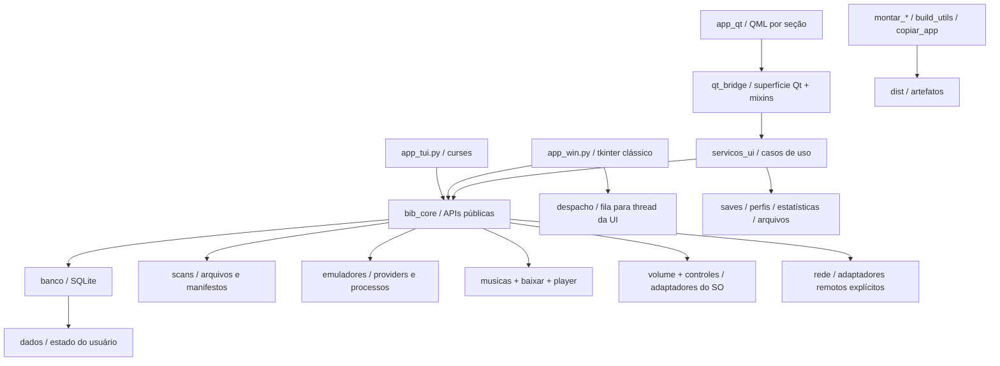

# Arquitetura e mapa de pastas

## Visão geral



Os frontends usam a mesma persistência. As regras ficam no núcleo; a GUI
constrói widgets/ações e a TUI conduz menus. A fachada `bib_core` reexporta
APIs para preservar consumidores antigos. Os módulos possuem alguns imports
locais deliberados para desfazer ciclos entre banco, scanners e providers.

## Árvore comentada

```text
Tucoteca/
├── README.md                         entrada funcional e técnica
├── CONTRIBUTING.md                   ambiente, testes e colaboração
├── LICENSE                           licença do código do Hub
├── TucoTeca.bat                       entrada Windows; BibliotecaHub.bat é alias
├── BibliotecaHub.sh/Mac.command       entradas Linux/macOS legadas
├── Montar-Universal.bat               entrada de empacotamento
├── .github/workflows/                matriz de testes
├── docs/
│   ├── ARQUITETURA.md                 este mapa
│   └── REVISAO_TECNICA.md             achados e evidência da revisão
├── codigo/
│   ├── bib_core.py                   fachada de compatibilidade
│   ├── bib_nucleo/                   núcleo e domínios pessoais
│   │   └── rede/                     adaptadores com BIBLIOTECA_REDE
│   ├── frontends/                    Qt, clássico e TUI
│   │   └── qml/secoes/               telas carregadas por Loader
│   ├── ferramentas/                  diagnóstico, entrega e builders
│   │   └── testes/                   casos e runner em sandbox
│   └── historico/                    arquivo local, ignorado
├── midia/fontes-capas/                opcional: placeholders gerados localmente
├── programa/                         runtime instalado localmente, ignorado
├── dados/                            coleção local, ignorada
└── dist/                             gerados, ignorados
```

`codigo/ferramentas/.cache/` guarda downloads de build e `.build/` guarda
árvores intermediárias. Não são fontes, não entram na entrega de engenharia.
As pastas físicas locais podem conter material de sessões antigas; o comando
de entrega seleciona somente fontes/documentos por allowlist.
Um clone limpo não precisa conter `midia/`, `programa/`, `dados/` ou `dist/`.
A pasta do projeto pode ser a **única** do PC: com `dados/` e `programa/`
na raiz (ambos ignorados pelo Git), `resolve_home()` em `base.py` prefere a
própria árvore à instalação canônica — bundles e clone dev compartilham a
mesma regra. Links do Wine (`dosdevices/*`, junctions de pastas do usuário)
não são copiáveis pelo Windows e são recriados pelo Wine no primeiro uso.
A reconciliação do histórico remoto com as revisões locais está documentada
em [RECONCILIACAO_GITHUB.md](RECONCILIACAO_GITHUB.md).

## Responsabilidade por módulo

| Módulo | Responsabilidade / fronteira |
|---|---|
| `config.py` | leitura única das `BIBLIOTECA_*` (paths, listas `;`/`,`, bools 0/1), defaults e singleton `cfg` — consumida por `base.py`, builders e testes |
| `base.py` | casa, raízes Win/Linux/Mac, tradução de caminhos, lock, texto, logs |
| `banco/` (pacote) | schema, migrações por colunas, CRUD jogos/músicas/fila, capas — `banco.py` fatiado em `_infra`/`jogos`/`catalogo` com fachada de compatibilidade (`__all__` idêntico) |
| `banco_desejos.py` | wishlist local, sincronização preservadora e histórico obtido |
| `scans/` (pacote) / `scans_hydra.py` | lojas/disco/ROMs e adaptador Hydra, preview, dedup e restore — `scans.py` fatiado na F2 do O2 sem mudar contratos |
| `emuladores/` (pacote) | Azahar/DeSmuME, processos/sessões, presets e overlay de mods — `emuladores.py` fatiado na F1 do O2 sem mudar contratos |
| `atualizacao.py` | download e atualização transacional, manifesto, rollback |
| `pacotes.py` | JSON, ZIP de coleção e backups versionados |
| `lixeira.py` | snapshot e desfazer de remoções (jogos com capa, desejos, vídeos); música fora por design |
| `arquivos.py` | temporário no mesmo disco + publicação atômica |
| `rede/repacks.py` (alias `repacks.py`) | extrair, organizar, selecionar exe, importar e confirmar archive |
| `cheats.py` | texto Gateway com liga/desliga e TID canônico |
| `texturas.py` | instalar/toggle/estado de packs por TID |
| `controles.py` | detecção de gamepads, formatos de binds e presets `[Controls]` |
| `musicas.py` | ID3/fallback, arquivos de áudio, capas de álbum e path portátil |
| `baixar.py` | Exportify, yt-dlp/FFmpeg, staging, conversão e fila persistente |
| `player.py` | playlist/transporte e backends MCI/afplay/players Linux |
| `volume.py` | volume geral Windows Core Audio; COM com vida limitada |
| `rede/fontes.py` | catálogos SteamRip/FitGirl, seleção de hosts e downloads |
| `rede/metadados.py` / `rede/binarios.py` | Steam de referência e instalação verificada de ferramentas |
| `rede/letras.py` / `rede/capas_libretro.py` / `rede/sponsorblock.py` | LRCLIB/LRC, capas e segmentos opt-in |
| `rede/torrents.py` (alias `torrents.py`) | leitura local de `.torrent/.fastresume`, sem depender da rede |
| `ferramentas.py` | manifesto editável, resolução relativa e comandos de sidecars/zipapps |
| `qbit.py` | perfil independente e Web API local do qBittorrent |
| `saves.py` | origens explícitas, snapshots SHA-256 e restauração com backup anterior |
| `sessoes_manuais.py` / `estatisticas.py` | reconciliação idempotente e histórico de sessões novas |
| `preferencias_pessoais.py` | Tuco/Isa, favoritos/filtros, atalhos e recursos opt-in |
| `screenshots.py` / `pastas_vigiadas.py` | imagens locais e detecção de arquivos estáveis |
| `organizacao_local.py` / `patches_rom.py` | cópia/hardlinks explícitos e IPS/BPS em uma nova ROM |
| `everything.py` | `es.exe` BYOB, limitado às raízes escolhidas; scanner como fallback |
| `api_local.py` | leitura HTTP opt-in, loopback, token, Host/Origin, sem rotas de execução |

### Frontends e ferramentas

| Arquivo | Função |
|---|---|
| `frontends/app_win.py` + `app_win_*.py` | App tkinter clássico **legado/congelado** (só correções críticas; desenvolvimento novo é só no Qt) em mixins por domínio; entry point, `NAV`, `messagebox` e top funcs preservados; acesso ao módulo por `late.py` (funciona como script e importado) |
| `frontends/desktop.py` | Dispatcher Qt ↔ clássico: abre o Qt quando PySide6 está presente (padrão) e cai no clássico como alternativa; saída 42 troca preservando lock |
| `frontends/app_qt.py` | Shell Qt Quick, lock, selftest e screenshot |
| `frontends/qt_bridge/` (pacote) | Superfície Qt no `HubBridge` (sinais + properties), lógica por domínio nos mixins, modelos e workers |
| `frontends/navegacao_controle.py` | Estado XInput → ações (direcional repete ao ser segurado); o Qt traduz para teclas e seções |
| `frontends/qt_emulacao.py` | Mods, texturas, cheats e presets do Azahar para o jogo selecionado; cada ação recarrega o estado |
| `frontends/servicos_ui/` (pacote) | Casos de uso desktop, `resumo_sistema`, `busca_global`, registro |
| `frontends/qml/` | shell `Main.qml`, `secoes/`, componentes, diálogos, navegador/player opcionais |
| `frontends/app_tui.py` + `tui_*.py` | Tui em mixins por domínio (entry point e `tui.curses` patchável preservados) |
| `frontends/despacho.py` | callbacks de workers entregues pela thread Tk |
| `frontends/aparencia.py` | tema local, elementos nine-slice, barras adaptáveis e painéis roláveis |
| `ferramentas/build_utils.py` | comum aos builders: SHA-256 de arquivo, escritor único de `.tar.xz` (Win/Linux/Mac, com diretórios) e download verificado (cache + `.part` atômico) |
| `ferramentas/diagnosticar.py` | sintaxe/exports/dependências/pastas/SQLite somente-leitura |
| `ferramentas/empacotar_fontes.py` | entrega da árvore atual + SHA-256 sem coleção |
| `ferramentas/montar_portatil.py` | Windows, Python embutido/Tk, ZIP/tar.xz/Inno e `copiar_app` |
| `ferramentas/montar_linux.py` | payload Linux + stub `.run`, desktop e desinstalação |
| `ferramentas/montar_mac.py` | payload + oficiais macOS, completo/leve |
| `ferramentas/montar_universal.py` | agrega artefatos dos 3 SOs |
| `ferramentas/montar_superhub.py` | variantes Windows x64; poda, revisão exata dos fontes, manifesto e provas pós-extração |
| `ferramentas/provar_qbit_runtime.py` | prova nativa do perfil/API com torrent local artificial |
| `ferramentas/provar_qt_runtime.py` | capturas, áudio/LRC em caminho longo, Chromium local e vídeo/retomada |
| `ferramentas/provar_integracoes_locais.py` | API HTTP real, snapshots, hardlinks, screenshots e vigia em casa descartável |

## Estado e modelo de dados

`dados/biblioteca.db` usa SQLite com journal DELETE, adequado à coleção
transportada entre sistemas. Migrações históricas são aditivas/por colunas
e a remoção de Citron foi incorporada. Não há um gerenciador externo de ORM.

| Tabela | Identidade e conteúdo |
|---|---|
| `jogos` | id local + uuid estável; título, caminhos por SO, opções, progresso, tags, mods, save_path |
| `musicas` | id local + `musica_sha` único; artista/título/álbum, path, capa, origem |
| `downloads` | id local; metadados CSV, estado, vídeo, staging, hash e erro |
| `desejos` | AppID Steam único; título, ordem, inclusão manual e estado/data obtido |
| `jogos_fts` | FTS5 com triggers; rebuild só se índice/triggers estiverem ausentes |
| `sessoes_historico` / `sessoes_reconciliadas` | horas novas por jogo/perfil e marcadores já aplicados |

`jogos` tem unicidade por título/executável/opções e índice de uuid. Scans
adicionam dedup por caminho normalizado; ROMs consideram também título/ROM
porque o emulador muda de Windows para Linux/macOS.

```text
dados/
  biblioteca.db          coleção SQLite
  backups/               snapshots DB/JSON e arquivos de saves
  capas/                 imagens finais de jogos e músicas
  presets/               configurações por provider e controles
  sessoes/               marcadores de sessões manuais
  mods/azahar/            biblioteca de packs normalizados
  musicas/               áudio final
  baixados/              staging da fila
  cache-wav/             PCM derivado para player Windows
  saves/                 dados centralizados/prefixo Wine
  screenshots/           galeria por uuid do jogo
  saves-config.json      origens de saves configuradas pelo usuário
  preferencias-pessoais.json  perfis, atalhos e opt-ins
  videos-posicoes.json   retomada de vídeo por SHA-256
  texturas/              material extra de packs
  erros.log              diagnóstico de falhas do runtime
```

Saves, mods e texturas também podem passar por junctions/symlinks e pelo
`user/` dos emuladores. Não tratar esses caminhos como simples diretórios
descartáveis. O overlay de mods registra arquivos próprios em `.hub-mods.json`.

## Fluxos e contratos

### Importar jogos

1. Detectar/classificar e mostrar preview (só leitura).
2. Fazer backup da coleção antes de confirmar a importação.
3. Validar, normalizar, dedupar e gravar; uuid existente restaura metadados,
   preservando os caminhos locais de execução.
4. Tentar capa sob a ação de importar; falha remota vira aviso.

Repacks: arquivo → staging extraído → exe confirmado → catálogo. O archive
original permanece se a importação falhar. O programa não executa setups
durante a extração.

Desejo → fonte: SteamRip escolhe o primeiro host compatível disponível;
importação confirmada marca o desejo como obtido, sem apagar o histórico.
FitGirl abre a página, não executa instaladores. Steam não é destino de
lançamento nem sincroniza conquistas/overlay.

### Áudio

CSV → `pendente` → `baixando` → `baixado` → conversão/importação → `pronta`.
Falha por faixa entra em `falha`. Finalização de arquivos usa temporários
onde implementada; staging e cache não viajam no pacote de coleção.

O driver Windows MCI também limita o caminho do WAV. Preparação em worker
usa cache temporário curto por SHA quando necessário (`Temp/TucoTeca-mci/`,
teto LRU de 1 GiB), sem renomear/mover o original. Se o TEMP herdado for longo,
consulta o temporário local real do usuário. Falha de cópia preserva o cache
anterior e produz erro claro; abertura/controle do dispositivo continuam na UI.

`importar_musicas` retorna `novos/ignorados/erros/capas`;
`importar_fila_pronta` retorna `novas/ignoradas/erros/avisos/capas`.
São contratos distintos: consumidores devem usar suas chaves exatas.

### Concorrência da GUI

- SQLite tem conexão própria no worker.
- Rede, hashing e conversão são trabalhos de fundo.
- `_depois` enfileira callbacks no `DespachanteUi`; só seu poll usa Tk.
- O player tem preparação separada de abertura/controle MCI. Aliases são
  locais à thread: todos os comandos nativos ficam na thread da UI.
- Tokens invalidam preparações antigas; Stop/fechar não deixam resultado
  atrasado iniciar ou interromper outra faixa.
- Erro de status é desconhecido, não fim. Auto-avançar exige fim confirmado.
- Backup pós-sessão aguarda horas/histórico e relê o opt-out persistido.

### Preservação dos saves e pacotes

Snapshots exigem identidade do jogo e as mesmas origens configuradas. Antes
de restaurar, validam caminhos/tipos/tamanhos e todos os SHA-256; o estado
atual é guardado mesmo quando parte dos saves foi apagada. Publicação é
atômica por arquivo, não uma transação de toda a pasta: falha de disco no
meio exige usar o backup prévio. Pacotes rejeitam links, nomes reservados,
duplicatas e escapes, com limites de tamanho/arquivos e backup pré-sobrescrita.

## Configuração por ambiente

| Variável | Uso |
|---|---|
| `BIBLIOTECA_HOME` | pasta-mãe da coleção `dados/` |
| `BIBLIOTECA_WIN_ROOT/LINUX_ROOT/MAC_ROOT` | raízes de tradução determinística |
| `BIBLIOTECA_SCAN_ROOTS` | raízes de varredura, separadas por `;` |
| `BIBLIOTECA_ROMS_ROOTS/ROMS_NDS_ROOTS` | ROMs por sistema |
| `BIBLIOTECA_AZAHAR_DIR/DESMUME_DIR` | instalação/bundle por provider |
| `BIBLIOTECA_EMULADOR_3DS/EMULADOR_NDS` | executável explícito |
| `BIBLIOTECA_AZAHAR_FLAGS/DESMUME_FLAGS` | opções de lançamento |
| `BIBLIOTECA_JOGOS_DIR` (alias legado `BIBLIOTECA_PIRATAS`) | pasta dos downloads de jogos (padrão `Meus Jogos Locais`; se a antiga `Piratas` já existir e a nova não, continua usando a antiga) |
| `BIBLIOTECA_7Z` | caminho explícito do 7-Zip |
| `BIBLIOTECA_REDE` | `0` bloqueia ações remotas do Hub; não é firewall dos apps externos nem bloqueio da API loopback |
| `BIBLIOTECA_WEBENGINE` | `0` força a alternativa sem Chromium |
| `BIBLIOTECA_WATCH` | pasta de pacotes vigiada; extração automática só com opt-in |
| `BIBLIOTECA_EVERYTHING` | caminho BYOB do CLI `es.exe` |
| `BIBLIOTECA_MUSICA_DIR` | origem de áudio local/Harmoni |
| `BIBLIOTECA_YTDLP/FFMPEG` | ferramentas externas |
| `BIBLIOTECA_CAPA_MUSICA_AUTO` | auto-capa; `0` desliga |
| `BIBLIOTECA_STEAMRIP_HOSTS` | preferência de hosts |
| `BIBLIOTECA_QBIT_DIR` | caminho explícito de `BT_backup/` do qBittorrent |
| `BIBLIOTECA_QBITTORRENT` | executável explícito do cliente |
| `BIBLIOTECA_QBIT_PROFILE` | raiz de perfis qBittorrent do Hub |
| `BIBLIOTECA_QBIT_API` | URL explícita da API em loopback |
| `BIBLIOTECA_QUICKJS/DENO` | runtime JavaScript explícito para yt-dlp |
| `HYDRA_DB_PATH` | origem Hydra explícita |
| `ISCC_EXE` | compilador Inno do builder Windows |

Defaults de caminhos refletem a máquina original. Ao desenvolver, use
overrides de ambiente. Bundles novos usam casa raiz; launchers reconhecem
também a coleção legada `dados/dados/biblioteca.db` sem movê-la.
A leitura dessas chaves é centralizada em `bib_nucleo/config.py` (somente
stdlib): `cfg` tipado, defaults documentados, parsing de listas (`;` para
raízes, `,` para hosts) e bools (`0/false/no/off` desligam). Código novo
consome `cfg`; o helper `_env` atende chamadas legadas.

## Testes e evolução

Casos cobrem persistência, identidade, scanners, overlays, rollback,
downloads simulados, GUI/TUI, áudio e volume. `executar.py` cria sandbox,
descobre `teste_*` e informa os pulos e falhas por ambiente.
`conftest.py` coleta por AST e executa os mesmos casos em processos separados;
`pytest --cobertura` agrega cobertura dos subprocessos. Provas nativas e
smokes remotos são separados dos casos herméticos e não usam jogos reais.

Os maiores pontos de acoplamento continuam `app_win.py`, `app_tui.py`
e `scans.py` (`emuladores.py` foi fatiado na F1 do O2 em
`emuladores/{azahar,desmume,provedores,presets,mods,lancamento,_comum}` e
`banco.py` em `banco/{_infra,jogos,catalogo}`; contratos e `__all__`
preservados). A decomposição futura deve seguir domínios
(catálogo, áudio, diálogos, sessões), mantendo contratos e fixtures antes
de mover métodos. Desejos, Hydra, sessões manuais e adaptadores remotos já
foram extraídos; isso não significa decomposição integral dos módulos grandes.
`despacho.py` e `copiar_app` são fronteiras já extraídas; `build_utils.py`
concentra o que os três builders compartilham (SHA-256, escritor único de
`.tar.xz` e download verificado), sem duplicar lógica de empacotamento.
