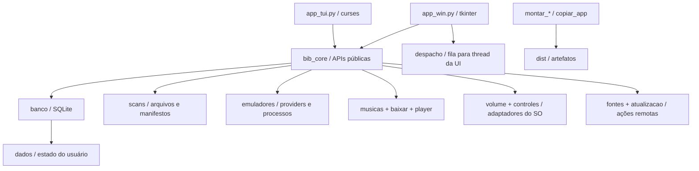

# Arquitetura e mapa de pastas

## Visão geral



Os frontends usam a mesma persistência. As regras ficam no núcleo; a GUI
constrói widgets/ações e a TUI conduz menus. A fachada `bib_core` reexporta
APIs para preservar consumidores antigos. Os módulos possuem alguns imports
locais deliberados para desfazer ciclos entre banco, scanners e providers.

## Árvore comentada

```text
biblioteca/
├── README.md                         entrada funcional e técnica
├── CONTRIBUTING.md                   ambiente, testes e colaboração
├── LICENSE                           licença do código do Hub
├── BibliotecaHub.bat/.sh/.command     launchers do checkout
├── Montar-Universal.bat               entrada de empacotamento
├── .github/workflows/                matriz de testes
├── docs/
│   ├── ARQUITETURA.md                 este mapa
│   └── REVISAO_TECNICA.md             achados e evidência da revisão
├── codigo/
│   ├── bib_core.py                   fachada de compatibilidade
│   ├── bib_nucleo/                   núcleo e integrações
│   ├── frontends/                    GUI/TUI e callbacks
│   ├── ferramentas/                  diagnóstico, entrega e builders
│   │   └── testes/                   casos e runner em sandbox
│   └── historico/                    arquivo local, ignorado
├── midia/fontes-capas/                artes de referência versionadas
├── dados/                            coleção local, ignorada
└── dist/                             gerados, ignorados
```

`codigo/ferramentas/.cache/` guarda downloads de build e `.build/` guarda
árvores intermediárias. Não são fontes, não entram na entrega de engenharia.
As pastas físicas locais podem conter material de sessões antigas; o comando
de entrega seleciona somente fontes/documentos por allowlist.

## Responsabilidade por módulo

| Módulo | Responsabilidade / fronteira |
|---|---|
| `base.py` | casa, raízes Win/Linux/Mac, tradução de caminhos, lock, texto, logs |
| `banco.py` | schema, migrações por colunas, CRUD jogos/músicas/fila, capas |
| `scans.py` | Hydra/lojas/disco/ROMs, metadados/ícones, preview, dedup e restore |
| `emuladores.py` | Azahar/DeSmuME, processos/sessões, presets e overlay de mods |
| `atualizacao.py` | download e atualização transacional, manifesto, rollback |
| `pacotes.py` | JSON, ZIP de coleção e backups versionados |
| `arquivos.py` | temporário no mesmo disco + publicação atômica |
| `repacks.py` | extrair, organizar, selecionar exe, importar e confirmar archive |
| `cheats.py` | texto Gateway com liga/desliga e TID canônico |
| `texturas.py` | instalar/toggle/estado de packs por TID |
| `controles.py` | detecção de gamepads, formatos de binds e presets `[Controls]` |
| `musicas.py` | ID3/fallback, arquivos de áudio, capas de álbum e path portátil |
| `baixar.py` | Exportify, yt-dlp/FFmpeg, staging, conversão e fila persistente |
| `player.py` | playlist/transporte e backends MCI/afplay/players Linux |
| `volume.py` | volume geral Windows Core Audio; COM com vida limitada |
| `fontes.py` | catálogo SteamRip, identificação de hosts e downloads |
| `torrents.py` | leitura local de `.torrent/.fastresume`, caminhos e peças recebidas |
| `ferramentas.py` | manifesto editável, resolução relativa e comandos de sidecars/zipapps |
| `qbit.py` | perfil independente e Web API local do qBittorrent |

### Frontends e ferramentas

| Arquivo | Função |
|---|---|
| `frontends/app_win.py` | App tkinter clássico CONGELADO (só correções críticas), grade, detalhes e ferramentas avançadas |
| `frontends/desktop.py` | Dispatcher Qt ↔ clássico (saída 42 troca preservando lock) |
| `frontends/app_qt.py` | Shell Qt Quick, lock, selftest e screenshot |
| `frontends/qt_bridge.py` | Modelos, seções, workers, player, paleta e sistema |
| `frontends/servicos_ui.py` | Casos de uso desktop, `resumo_sistema`, `busca_global`, registro |
| `frontends/qml/` | `Main.qml`, componentes, `Theme.qml`, HUD + Início + paleta |
| `frontends/app_tui.py` | Tui, desenho, prompts, menus e loop de terminal |
| `frontends/despacho.py` | callbacks de workers entregues pela thread Tk |
| `frontends/aparencia.py` | tema local, elementos nine-slice, barras adaptáveis e painéis roláveis |
| `ferramentas/diagnosticar.py` | sintaxe/exports/dependências/pastas/SQLite somente-leitura |
| `ferramentas/empacotar_fontes.py` | entrega da árvore atual + SHA-256 sem coleção |
| `ferramentas/montar_portatil.py` | Windows, Python embutido/Tk, ZIP/tar.xz/Inno e `copiar_app` |
| `ferramentas/montar_linux.py` | payload Linux + stub `.run`, desktop e desinstalação |
| `ferramentas/montar_mac.py` | payload + oficiais macOS, completo/leve |
| `ferramentas/montar_universal.py` | agrega artefatos dos 3 SOs |
| `ferramentas/montar_superhub.py` | runtime completo Windows x64; poda, manifesto e provas pós-extração |
| `ferramentas/provar_qbit_runtime.py` | prova nativa do perfil/API com torrent local artificial |

## Estado e modelo de dados

`dados/biblioteca.db` usa SQLite com journal DELETE, adequado à coleção
transportada entre sistemas. Migrações históricas são aditivas/por colunas
e a remoção de Citron foi incorporada. Não há um gerenciador externo de ORM.

| Tabela | Identidade e conteúdo |
|---|---|
| `jogos` | id local + uuid estável; título, caminhos por SO, opções, progresso, tags, mods, save_path |
| `musicas` | id local + `musica_sha` único; artista/título/álbum, path, capa, origem |
| `downloads` | id local; metadados CSV, estado, vídeo, staging, hash e erro |
| `desejos` | AppID Steam único; título, ordem e proteção da inclusão manual |

`jogos` tem unicidade por título/executável/opções e índice de uuid. Scans
adicionam dedup por caminho normalizado; ROMs consideram também título/ROM
porque o emulador muda de Windows para Linux/macOS.

```text
dados/
  biblioteca.db          coleção SQLite
  backups/               snapshots DB/JSON e arquivos de saves
  capas/                 imagens finais de jogos e músicas
  presets/               configurações por provider e controles
  sessoes/               marcadores de sessões manuais
  mods/azahar/            biblioteca de packs normalizados
  musicas/               áudio final
  baixados/              staging da fila
  cache-wav/             PCM derivado para player Windows
  saves/                 dados centralizados/prefixo Wine
  texturas/              material extra de packs
  erros.log              diagnóstico de falhas do runtime
```

Saves, mods e texturas também podem passar por junctions/symlinks e pelo
`user/` dos emuladores. Não tratar esses caminhos como simples diretórios
descartáveis. O overlay de mods registra arquivos próprios em `.hub-mods.json`.

## Fluxos e contratos

### Importar jogos

1. Detectar/classificar e mostrar preview (só leitura).
2. Fazer backup da coleção antes de confirmar a importação.
3. Validar, normalizar, dedupar e gravar; uuid existente restaura metadados,
   preservando os caminhos locais de execução.
4. Tentar capa sob a ação de importar; falha remota vira aviso.

Repacks: arquivo → staging extraído → exe confirmado → catálogo. O archive
original permanece se a importação falhar. O programa não executa setups
durante a extração.

### Áudio

CSV → `pendente` → `baixando` → `baixado` → conversão/importação → `pronta`.
Falha por faixa entra em `falha`. Finalização de arquivos usa temporários
onde implementada; staging e cache não viajam no pacote de coleção.

`importar_musicas` retorna `novos/ignorados/erros/capas`;
`importar_fila_pronta` retorna `novas/ignoradas/erros/avisos/capas`.
São contratos distintos: consumidores devem usar suas chaves exatas.

### Concorrência da GUI

- SQLite tem conexão própria no worker.
- Rede, hashing e conversão são trabalhos de fundo.
- `_depois` enfileira callbacks no `DespachanteUi`; só seu poll usa Tk.
- O player tem preparação separada de abertura/controle MCI. Aliases são
  locais à thread: todos os comandos nativos ficam na thread da UI.
- Tokens invalidam preparações antigas; Stop/fechar não deixam resultado
  atrasado iniciar ou interromper outra faixa.
- Erro de status é desconhecido, não fim. Auto-avançar exige fim confirmado.

## Configuração por ambiente

| Variável | Uso |
|---|---|
| `BIBLIOTECA_HOME` | pasta-mãe da coleção `dados/` |
| `BIBLIOTECA_WIN_ROOT/LINUX_ROOT/MAC_ROOT` | raízes de tradução determinística |
| `BIBLIOTECA_SCAN_ROOTS` | raízes de varredura, separadas por `;` |
| `BIBLIOTECA_ROMS_ROOTS/ROMS_NDS_ROOTS` | ROMs por sistema |
| `BIBLIOTECA_AZAHAR_DIR/DESMUME_DIR` | instalação/bundle por provider |
| `BIBLIOTECA_EMULADOR_3DS/EMULADOR_NDS` | executável explícito |
| `BIBLIOTECA_AZAHAR_FLAGS/DESMUME_FLAGS` | opções de lançamento |
| `BIBLIOTECA_JOGOS_DIR` (alias legado `BIBLIOTECA_PIRATAS`) | pasta dos downloads de jogos (padrão `Meus Jogos Locais`; se a antiga `Piratas` já existir e a nova não, continua usando a antiga) |
| `BIBLIOTECA_7Z` | caminho explícito do 7-Zip |
| `BIBLIOTECA_REDE` | `0` desliga todas as integrações de rede (modo avião) |
| `BIBLIOTECA_MUSICA_DIR` | origem de áudio local/Harmoni |
| `BIBLIOTECA_YTDLP/FFMPEG` | ferramentas externas |
| `BIBLIOTECA_CAPA_MUSICA_AUTO` | auto-capa; `0` desliga |
| `BIBLIOTECA_STEAMRIP_HOSTS` | preferência de hosts |
| `BIBLIOTECA_QBIT_DIR` | caminho explícito de `BT_backup/` do qBittorrent |
| `BIBLIOTECA_QBITTORRENT` | executável explícito do cliente |
| `BIBLIOTECA_QBIT_PROFILE` | raiz de perfis qBittorrent do Hub |
| `BIBLIOTECA_QBIT_API` | URL explícita da API em loopback |
| `BIBLIOTECA_QUICKJS/DENO` | runtime JavaScript explícito para yt-dlp |
| `HYDRA_DB_PATH` | origem Hydra explícita |
| `ISCC_EXE` | compilador Inno do builder Windows |

Defaults de caminhos refletem a máquina original. Ao desenvolver, use
overrides de ambiente. Bundles novos usam casa raiz; launchers reconhecem
também a coleção legada `dados/dados/biblioteca.db` sem movê-la.

## Testes e evolução

Casos cobrem persistência, identidade, scanners, overlays, rollback,
downloads simulados, GUI/TUI, áudio e volume. `executar.py` cria sandbox,
descobre `teste_*` e informa os pulos e falhas por ambiente.

Os maiores pontos de acoplamento continuam `app_win.py`, `app_tui.py`,
`emuladores.py` e `scans.py`. A decomposição futura deve seguir domínios
(catálogo, áudio, diálogos, sessões), mantendo contratos e fixtures antes
de mover métodos. `despacho.py` e `copiar_app` são fronteiras já extraídas.
